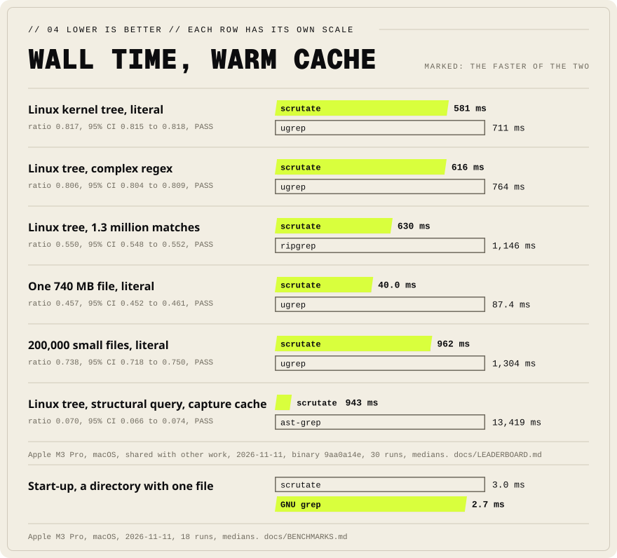

<h3 align="center">Universal instant code search and persistent code intelligence, in one Rust binary.</h3>

<p align="center">
  <a href="#licence"></a>
  <a href="#install"></a>
  <a href="#status-010"></a>
</p>

<p align="center">
  <a href="https://scrutate.github.io/playground/">
    <picture>
      <source media="(max-width: 600px)" srcset="docs/assets/cta-playground-phone.svg">
      
    </picture>
  </a>
</p>

<p align="center">
  <a href="#install"><b>Install</b></a>&nbsp;&nbsp;&middot;&nbsp;&nbsp;<a href="#quick-start"><b>Quick start</b></a>&nbsp;&nbsp;&middot;&nbsp;&nbsp;<a href="#benchmarks"><b>Benchmarks</b></a>&nbsp;&nbsp;&middot;&nbsp;&nbsp;<a href="#documentation"><b>Documentation</b></a>&nbsp;&nbsp;&middot;&nbsp;&nbsp;<a href="docs/FAQ.md"><b>Questions</b></a>&nbsp;&nbsp;&middot;&nbsp;&nbsp;<a href="https://scrutate.github.io/playground/"><b>Playground</b></a>&nbsp;&nbsp;&middot;&nbsp;&nbsp;<a href="https://scrutate.github.io"><b>Website</b></a>
</p>

<p align="center">
  <picture>
    <source media="(max-width: 600px)" srcset="docs/assets/hero-phone.svg">
    
  </picture>
</p>

<p align="center"></p>

## Two engines, one binary

<p align="center">
  <picture>
    <source media="(max-width: 600px)" srcset="docs/assets/engines-phone.svg">
    
  </picture>
</p>

Scrutate is an open-source code search tool for the terminal, editors and AI coding agents: two
independent engines behind one CLI ([questions and answers](docs/FAQ.md)).

**Engine A, universal instant search.** No index, no parsers, no background process. Literal,
regex (linear-time, size-limited), identifier (all casings), fuzzy, multiline, whole-word and
inverted matching over every readable file, with `.gitignore` rules, a parallel walk, streaming,
cancellation, and colour or JSON Lines. Built on ripgrep's own `grep-*` crates and a modified copy of
its `ignore` crate, and differentially tested against ripgrep.

**Engine B, code intelligence.** A persistent, incremental index (SQLite and memory-mapped
segments): tree-sitter symbols from 61 grammars (74 with `--features extra-langs`), keyword
heuristics for the rest, call edges, imports, BM25 postings, semantic vectors, a LightGBM ranker,
and a trigram text index that answers grep queries with Engine A's exact output. It answers the
questions in [What it does](#what-it-does), and what a git diff touches.

[How the engines work and why](docs/ARCHITECTURE.md)

<p align="center"></p>

## Quick start

Build the binary ([Install](#install)), or try both engines first in the
[playground](https://scrutate.github.io/playground/), which runs scrutate in your browser. Every
command, option and exit code: [docs/CLI.md](docs/CLI.md).

### Search any folder, no index (Engine A)

```sh
scrutate grep "refresh_token" .                 # Engine A: instant, index-free, ignore-aware search
scrutate grep --ident refreshToken .            #   one spelling finds refresh_token / RefreshToken / REFRESH_TOKEN
scrutate grep --fuzzy=1 "shortest_pth" .        #   approximate matching (Myers bit-parallel)
scrutate grep --fuzzy-regex=1 '(get|set)_valu'  #   a regex within N edits
scrutate grep -P '(?<=self\.)cache\b' .         #   PCRE2: look-around, backreferences
scrutate grep -z "TODO" dist/                   #   inside zip/tar archives and compressed files
```

### Index the repository (Engine B)

```sh
scrutate index && scrutate grep --index "PM_RESUME"   # Engine B text index: the same answer, from a trigram index
scrutate search "where do we renew expired tokens"   # Engine B: ranked search by meaning, learned ranker
scrutate callers refresh_token                  #   call graph, definitions, references, outline
scrutate read --symbol refresh_token            #   one whole definition, or a file's lines
scrutate refs Graph --def networkx/classes/graph.py   # references resolved through imports and scopes
scrutate dupes                                  #   exact and near-duplicate functions
scrutate dead                                   #   definitions nothing uses, entry points left out
scrutate tsquery python '(class_definition name: (identifier) @c)'   # structural search (tree-sitter)
scrutate impact --base main...                  #   what my diff changes, who calls it, which tests to run
scrutate files srch.rs                          #   a file by a misspelt name, files read lately first
```

### Serve agents and editors

```sh
scrutate serve --watch                          # MCP server for AI coding agents, index kept fresh
scrutate lsp                                    # language server for editors (VS Code, JetBrains)
```

<p align="center"></p>

## What it does

<table>
<tr>
<td width="33%" valign="top"><br><b>Regex</b><br>Literal, regex in linear time, and PCRE2 (<code>-P</code>).</td>
<td width="33%" valign="top"><br><b>Any casing</b><br>One spelling finds snake, camel and upper case (<code>--ident</code>).</td>
<td width="33%" valign="top"><br><b>Fuzzy</b><br>Matches within N edits, also for a regex (<code>--fuzzy</code>).</td>
</tr>
<tr>
<td valign="top"><br><b>Archives</b><br>Inside zip and tar files and compressed files (<code>-z</code>).</td>
<td valign="top"><br><b>Text index</b><br>A trigram index, Engine A's exact output (<code>grep --index</code>).</td>
<td valign="top"><br><b>Ranked</b><br>By meaning, name or identifier, with a learned ranker (<code>search</code>).</td>
</tr>
<tr>
<td valign="top"><br><b>Call graph</b><br>Definitions, callers, callees, outlines, imports (<code>callers</code>).</td>
<td valign="top"><br><b>References</b><br>Each name resolved through imports and scopes (<code>refs</code>).</td>
<td valign="top"><br><b>Duplicates</b><br>Exact and near copies of a function, similar code (<code>dupes</code>).</td>
</tr>
<tr>
<td valign="top"><br><b>Structure</b><br>tree-sitter queries on the syntax tree (<code>tsquery</code>).</td>
<td valign="top"><br><b>Kept fresh</b><br>An incremental index that follows edits (<code>watch</code>).</td>
<td valign="top"><br><b>Many repos</b><br>Search other repositories too (<code>search --also</code>).</td>
</tr>
<tr>
<td valign="top"><br><b>MCP server</b><br>Tools for AI coding agents, on stdio (<code>serve</code>).</td>
<td valign="top"><br><b>Editors</b><br>A language server: definitions, references, symbols (<code>lsp</code>).</td>
<td valign="top"><br><b>Python</b><br>Streamed grep with the GIL released, and the index (<a href="#python">bindings</a>).</td>
</tr>
</table>

<p align="center"></p>

## Benchmarks

Every measurement below comes from a result file under `bench/results/`, written by scripts in
`bench/` you can rerun; a comparison whose run left no committed result file is named without figures.

<p align="center">
  <picture>
    <source media="(max-width: 600px)" srcset="docs/assets/bench-walltime-phone.svg">
    
  </picture>
</p>

Compared against, one row per tool, from the result files docs/LEADERBOARD.md names (written by
`bench/make_compared_md.py`). Those are the results of an earlier build, filed as superseded; a
run on the release binary replaces them. A share is scrutate's median time, size or memory over the
tool's, so under 1 is scrutate ahead. "Lower median" is not a verdict: a verdict needs 30 runs or
more of both tools, and only the last column ranks. "Compared on" counts the benchmarks where both
tools answered right; a tool's wrong answers are counted apart and left out.

<!-- compared-against: begin -->
<!-- inputs: --engine-a bench/results/macos-arm64/superseded/leaderboard-warm-9aa0.json --engine-a bench/results/macos-arm64/superseded/leaderboard-cold-9aa0.json --engine-a bench/results/linux-aarch64/superseded/leaderboard-warm-261e.json --engine-a bench/results/linux-aarch64/superseded/leaderboard-cold-261e.json --indexed bench/results/macos-arm64/superseded/indexed-9aa0.json --indexed bench/results/linux-aarch64/superseded/indexed-261e.json -->

| Tool | Compared on | Scrutate against it | Ranked at 95% |
|---|---|---|---|
| GNU grep 3.12 | macos-arm64: 30 warm, 5 cold; linux-aarch64 VM: 8 warm, 4 cold | 0.01 to 0.48 of its median; lower median on 47 of 47; GNU grep wrong on 7 more, left out | never the fastest other tool, so not ranked |
| ripgrep 15.2.0 | macos-arm64: 35 warm, 5 cold; linux-aarch64 VM: 13 warm, 4 cold | 0.05 to 0.93 of its median; lower median on 57 of 57 | PASS 24 of the 24 where it was the fastest other tool |
| ack v3.10.0 | macos-arm64: 28 warm, 5 cold; not compared on linux-aarch64 VM | 0.01 to 0.13 of its median; lower median on 33 of 33; ack wrong on 5 more, left out | never the fastest other tool, so not ranked |
| ag 2.2.0 | macos-arm64: 28 warm, 5 cold; linux-aarch64 VM: 8 warm, 3 cold | 0.02 to 0.63 of its median; lower median on 44 of 44; ag wrong on 13 more, left out | never the fastest other tool, so not ranked |
| git grep 2.56.0 (macos-arm64), 2.39.5 (linux-aarch64 VM) | macos-arm64: 32 warm, 5 cold; linux-aarch64 VM: 9 warm, 4 cold | 0.02 to 0.72 of its median; lower median on 50 of 50; git grep wrong on 5 more, left out | PASS 6 of the 6 where it was the fastest other tool |
| ugrep 7.8.5 | macos-arm64: 32 warm, 5 cold; linux-aarch64 VM: 11 warm, 4 cold | 0.15 to 0.85 of its median; lower median on 52 of 52; ugrep wrong on 5 more, left out | PASS 27 of the 27 where it was the fastest other tool |
| ast-grep 0.51.1 | macos-arm64: 2 warm; linux-aarch64 VM: 1 warm | 0.04 to 0.16 of its median; lower median on 3 of 3 with scrutate's capture cache filled; parse for parse (`tsquery --no-cache`): no committed result file | PASS 2 of the 2 where it was the fastest other tool |
| Zoekt commit a5a933b (2026-11-03) | macos-arm64, linux-aarch64 VM: the text index, a process per query | index build 0.04, index size 0.10, query p50 0.23 to 0.37, query memory 0.04 to 0.05 of Zoekt's | index size PASS 2 of 2; query memory PASS 2 of 2; the timed metrics are measured, not ranked (under 30 runs); kept running as a server: no committed result file |
| livegrep commit 923d5ad | linux-aarch64 VM: the text index, a process per query; not measured on macos-arm64 | index build 0.17, index size 0.06, query p50 0.15, query memory 0.01 of livegrep's | index size PASS 1 of 1; query memory PASS 1 of 1; the timed metrics are measured, not ranked (under 30 runs); kept running as a server: no committed result file |

<!-- compared-against: end -->

[docs/LEADERBOARD.md](docs/LEADERBOARD.md) is generated from the raw results in `bench/results/`:
at least 30 runs of scrutate and of the fastest other tool, 95% intervals. On the development Mac
(Apple M3 Pro, shared with other work, so not a publishable #1 claim), Engine A is significantly
fastest in all 37 warm-cache benchmarks and all 5 cold-cache ones; 2 of the 37 are structural
search (`tsquery`), not Engine A. Its lead over the next tool:

- Linux kernel tree: 15 to 30% on 12 of 13 text searches, 45% on the one with 1.3 million matching
  lines.
- LLVM: 15 to 30% on five of six rows. 200,000 small files: 24 to 26%. A 211-file repository: 17
  to 24%. A 740 MB file: 43 to 58%. Cold cache: 23 to 28%.

Structural search is 6 and 14 times faster than ast-grep with scrutate's capture cache filled (a
cache hit: it parses no file while ast-grep parses every one). Parse for parse (`tsquery --no-cache`),
the one run so far, on a 4-vCPU Linux x86_64 server, had ast-grep ahead on the Linux tree; its result
file is not committed, so the figures wait for a recorded run
([Competitive](docs/COMPETITIVE.md#2-against-ast-grep-structural-search)).

<p align="center">
  <picture>
    <source media="(max-width: 600px)" srcset="docs/assets/bench-index-phone.svg">
    
  </picture>
</p>

Against Zoekt's command-line tools on the development Mac, a fresh process per query on both
sides, the text index builds 25 times faster, is a tenth of the size, answers in 0.37 of the
median time and serves 1.2 times the queries per second. It leads on both indexed metrics ranked
so far, index size and query memory; the timed figures rest on fewer than the
30 runs per tool a verdict needs (5 builds, 20 runs per query, 3 throughput runs), so they are
published as measured, not ranked. The update after 100 edits is not compared: Zoekt has no
incremental mode and rebuilds.

In a 5-CPU Linux virtual machine on the same Mac, Engine A is significantly fastest on all 14
Linux-tree benchmarks and all 4 cold-cache ones; one of the 14 is structural search, not
Engine A. Run the same way, a process per query (`scrutate grep --index`, Zoekt's CLI and a
livegrep client asking its `codesearch` server), the text index
leads Zoekt and livegrep on both indexed metrics ranked so far, index size and query memory;
its timed metrics are measured, not ranked, for the same reason (both rivals rebuild where the
index updates).

Kept running as servers, livegrep and Zoekt answer faster than that process per query and than
Scrutate's own MCP server (`grep_code`), in a `bench/yardstick.py` W3 run on a 4-CPU Linux box whose
result file is not committed, so the figures wait for a recorded run. That run predates the server keeping its look of the tree between calls
(on macOS while its kqueue is in place, so not on a tree with more files and directories than half
of the descriptor limit (the hard limit or `kern.maxfilesperproc`, whichever is lower) less 1,024,
about 29,700 where it is 61,440),
which made those calls faster in `bench/grep_code_pair.py` runs on another machine and on a Mac (a 24,866-file
part of the same tree), whose result files are not committed either ([docs/COMPETITIVE.md](docs/COMPETITIVE.md#3-against-zoekt-and-livegrep-indexed-search)).

More: [docs/BENCHMARKS.md](docs/BENCHMARKS.md), [docs/dashboard.html](docs/dashboard.html),
[docs/COMPETITIVE.md](docs/COMPETITIVE.md) and [docs/QUALITY.md](docs/QUALITY.md) (see
[Documentation](#documentation)).

<p align="center"></p>

## For AI agents and editors

`scrutate serve` is an MCP server on stdio, started inside a repository or given `--root`;
`--watch` also updates the index from filesystem events.

```sh
scrutate --root /path/to/repo serve --watch
```

### Set up your agent

`scrutate setup` adds one entry that runs this binary by its absolute path. Every other byte of
the agent's file stays (a JSON file gains only the comma before the new entry); Claude Code's user file goes through `claude mcp add-json`
when `claude` is on `PATH`, and Claude Code writes that file itself:

```sh
scrutate setup claude          # also codex, opencode, cursor, gemini
scrutate setup cursor --project   # the repository's .cursor/mcp.json instead of the user's file
scrutate setup claude --hook   # also the hooks for Claude Code's Grep and its rg, grep and find
scrutate setup claude --uninstall   # take back exactly what setup wrote, the hooks included
```

`--dry-run` writes nothing. Only `--instructions`, and `--uninstall` taking its block out, touch
`CLAUDE.md`, `AGENTS.md` and `GEMINI.md`. `scrutate hook stats` shows the bytes the hook sent against Grep's. Details:
[docs/CLI.md](docs/CLI.md#setup-and-the-grep-hook).

`scrutate lsp` is a Language Server Protocol server on stdio: definitions, references and symbols
from the index.

```sh
scrutate --root /path/to/repo lsp
```

Client set-up: [MCP clients](integrations/mcp/README.md), [VS Code](integrations/vscode/README.md),
[Neovim](integrations/neovim/README.md), [JetBrains](integrations/jetbrains/), and CI and
pre-commit in [integrations/](integrations/).

<p align="center"></p>

## Install

From source, with Rust 1.91 or newer (`rust-toolchain.toml` pins 1.100.0):

```sh
cargo build --release -p scrutate --locked      # target/release/scrutate
```

No release archive is published yet. When a version is tagged, `.github/workflows/release.yml`
builds archives, checksums, Sigstore attestations, musl binaries and wheels for every platform
([docs/INSTALL.md](docs/INSTALL.md)).

<p align="center"></p>

## Python

`pip install` the wheel maturin builds from `crates/scrutate-py`:

```python
import scrutate
for m in scrutate.grep("TODO", ["."], mode="literal"):      # streamed, GIL released
    print(m.path, m.line, m.text)
repo = scrutate.Repo("."); repo.index()
print(repo.search("parse a date string", k=5))
```

<p align="center"></p>

## Status: 0.1.0

The version being prepared as the first release (no `v0.1.0` tag or GitHub release yet), **not** declared production-ready:
[docs/RELEASE_READINESS.md](docs/RELEASE_READINESS.md) says what is and is not verified.

**Platforms.** All six are supported: macOS arm64 and x86_64, Linux aarch64 and x86_64 (static musl
binaries too), Windows x86_64 and ARM64. macOS arm64 and Linux are built and tested here, and
macOS x86_64 and Windows x86_64 are cross-built here. On GitHub's runners (CI run 43408907893, commit
`8f60af9`) every job that ran passed (the one for pull requests alone was skipped): the Rust tests, and a wheel built, installed and tested for CPython 3.13
and free-threaded 3.14, on all six platforms, and the editor integrations
([docs/INSTALL.md](docs/INSTALL.md)). CI run 43013926055 (commit `9384c18`) was the first such run
of the Rust tests.

**Tests.** The last recorded run ([docs/TEST_RESULTS.md](docs/TEST_RESULTS.md), 2026-11-17)
passed 1,436 Rust tests (unit, per-language snapshot, robustness, property, end-to-end CLI and MCP,
incremental parsing), the Python and bindings tests, the ranking quality floor, fuzz regressions and a reproducible-build
check; CI runs the ranking pins and the floor too. Engine A agrees with
ripgrep on every random corpus and pattern of its differential test (200 in that run), each run as shipped and again in one forced mode:
the one-thread walk, the parallel walk, a hand-over between them, or a file over 64 KiB searched
in pieces.

**Engine B.** Its models train on rows it writes itself. A test pins its features and scores bit
for bit, and CI fails when its ranking quality falls below a recorded floor. On held-out code in
Python and five more languages the learned ranker beats its lexical layer for function and type
answers on every query type with 50 queries or more but one, which ties
([docs/QUALITY.md](docs/QUALITY.md)).

**Code checks.** `cargo clippy -D warnings` and `cargo fmt` are clean; `cargo audit` reports no
vulnerabilities; an SBOM is generated.

**Reporting a vulnerability.** Report it privately through the repository's Security tab, "Report a
vulnerability" (<https://github.com/scrutate/scrutate/security/advisories/new>), never in a
public issue ([docs/SECURITY.md](docs/SECURITY.md#reporting)).

<p align="center"></p>

## Documentation

<table>
<tr>
<td width="50%" valign="top"> <a href="docs/README.md"><b>Documentation hub</b></a><br>Where to start, and a map of every document</td>
<td width="50%" valign="top"> <a href="docs/CLI.md"><b>CLI</b></a><br>Every command, option, exit code, environment variable, config file</td>
</tr>
<tr>
<td valign="top"> <a href="docs/FAQ.md"><b>Questions</b></a><br>What scrutate is, and the questions people ask first</td>
<td valign="top"> <a href="docs/INSTALL.md"><b>Install</b></a><br>Build it, the platforms, the package definitions</td>
</tr>
<tr>
<td valign="top"> <a href="docs/ARCHITECTURE.md"><b>Architecture</b></a><br>How the engines work and why</td>
<td valign="top"> <a href="docs/LEADERBOARD.md"><b>Leaderboard</b></a><br>The benchmark leaderboard: every tool, every benchmark, confidence intervals, statuses (generated)</td>
</tr>
<tr>
<td valign="top"> <a href="docs/BENCHMARKS.md"><b>Benchmarks</b></a><br>Latency, CPU, memory, start-up, concurrency and index metrics against grep-class tools (generated)</td>
<td valign="top"> <a href="docs/QUALITY.md"><b>Quality</b></a><br>Ranking quality on held-out code (MRR, hit@k)</td>
</tr>
<tr>
<td valign="top"> <a href="docs/LANGUAGES.md"><b>Languages</b></a><br>Verified language capability registry (generated)</td>
<td valign="top"> <a href="docs/SECURITY.md"><b>Security</b></a><br>Threat model, controls, evidence, residual risks</td>
</tr>
<tr>
<td valign="top"> <a href="docs/TRACEABILITY.md"><b>Traceability</b></a><br>Every mission requirement to implementation to evidence to PASS/PARTIAL/BLOCKED</td>
<td valign="top"> <a href="docs/RELEASE_READINESS.md"><b>Release readiness</b></a><br>What 0.1.0 is, remaining defects and incomplete requirements</td>
</tr>
<tr>
<td valign="top"> <a href="docs/COMPETITIVE.md"><b>Competitive</b></a><br>Evidence-based positioning against existing tools</td>
<td valign="top"> <a href="docs/NAMING.md"><b>Naming</b></a><br>How the name was chosen and what was (not) checked</td>
</tr>
<tr>
<td valign="top"> <a href="docs/TEST_RESULTS.md"><b>Test results</b></a><br>Every quality gate with its command and output (generated)</td>
<td valign="top"> <a href="docs/DELIVERY.md"><b>Delivery</b></a><br>Where each deliverable lives, and the release artifacts with their hashes</td>
</tr>
<tr>
<td valign="top"> <a href="docs/RELEASING.md"><b>Releasing</b></a><br>The release checklist</td>
<td valign="top"> <a href="docs/dashboard.html"><b>Dashboard</b></a><br>Every benchmark run so far, charted (generated)</td>
</tr>
<tr>
<td valign="top"> <a href="GLOSSARY.md"><b>Glossary</b></a><br>The words this codebase uses for its own concepts</td>
<td valign="top"> <a href="integrations/"><b>Integrations</b></a><br>VS Code, Neovim, JetBrains, GitHub Action, GitLab, Bitbucket, MCP, pre-commit</td>
</tr>
<tr>
<td valign="top" colspan="2"> <b>Also</b><br><a href="docs/DEPENDENCIES.md">DEPENDENCIES</a>, <a href="docs/ROADMAP.md">ROADMAP</a>, <a href="docs/RESEARCH.md">RESEARCH</a>, <a href="CHANGELOG.md">CHANGELOG</a>, <a href="CONTRIBUTING.md">CONTRIBUTING</a></td>
</tr>
</table>

<p align="center"></p>

## Sponsor and hire

Scrutate is free. To fund it,
[sponsor the maintainer on GitHub](https://github.com/sponsors/crisnahine) or
[buy a coffee](https://buymeacoffee.com/crisnahine). The maintainer also takes paid work:

- a commercial licence or other terms, where a company's policy needs them
- paid support
- sponsored features
- work for hire on code search and code intelligence

To ask, use the [GitHub profile](https://github.com/crisnahine) or
[open an issue](https://github.com/scrutate/scrutate/issues/new?title=Commercial%20inquiry)
titled "Commercial inquiry" with no details: the maintainer answers with a private channel.

<p align="center"></p>

## Licence

Scrutate is licensed under either of

- the MIT licence ([LICENSE-MIT](LICENSE-MIT))
- the Apache License 2.0 ([LICENSE-APACHE](LICENSE-APACHE))

at your option (SPDX: `MIT OR Apache-2.0`). That covers the code, the models, the documents and
images, the integrations and packaging, the benchmark harness and its results, and the tests. The
vendored walker in `vendor/ignore` (the crate `scrutate-ignore`) keeps its upstream terms,
`Unlicense OR MIT`.

Every crate compiled into the binary has a licence compatible with both (MIT, Apache-2.0, BSD,
BSL-1.0, ISC, Zlib, Unlicense, 0BSD, Unicode-3.0 or CC0-1.0). Their licence and notice files are
in `THIRD_PARTY_NOTICES.txt` (`tools/third_party_notices.py`), included in release archives, wheels
and the `.deb` and `.rpm` packages.

Contributions are accepted under the [contributor licence agreement](CLA.md) and offered under
the same two licences. The name and the logo are covered by the [trademark policy](TRADEMARKS.md).
